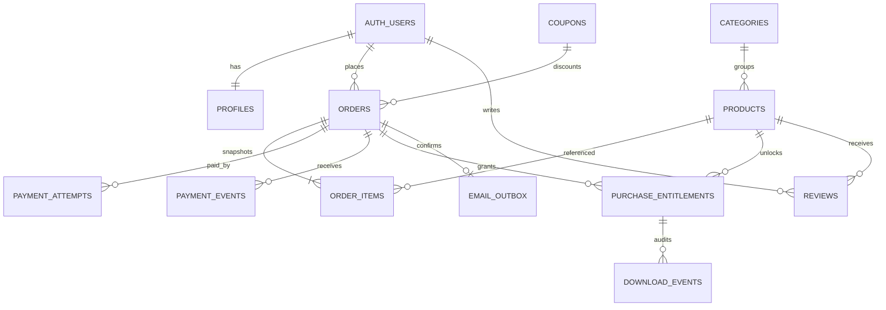

# Bookivo backend setup

This project contains the frontend client, a local Supabase migration, and Edge Functions for checkout, payment verification, webhooks, downloads, and administration. **Nothing in this change has been applied to the hosted Supabase project or deployed.** Review and run each hosted command yourself after configuring the external accounts.

## What runs where

- The browser receives only `VITE_SUPABASE_URL` and the Supabase publishable key. Both are public client configuration; Row Level Security (RLS) controls access.
- Database prices and coupon calculations run inside the `create_checkout_order` database function. The browser submits product IDs and quantities only.
- Cashfree credentials, the Supabase service role key, and Brevo credentials stay in Supabase Edge Function secrets. Never use a `VITE_` prefix for those values.
- Paid PDFs belong in the private `paid-ebooks` bucket. No customer can read that bucket directly. The download function checks a paid, unrevoked entitlement and issues a 60-second signed URL.
- Product covers and promotion images belong in the public `product-media` bucket. Do not put paid ebooks there.
- Payment confirmation is recorded only after Cashfree's order/payment API confirms it. The webhook is signature-checked, confirmed against Cashfree, and processed idempotently.

## Local setup

1. Install Docker Desktop and the Supabase CLI using the [official CLI installation guide](https://supabase.com/docs/guides/cli).
2. Copy `.env.example` to `.env.local`. Fill `VITE_SUPABASE_URL` and `VITE_SUPABASE_PUBLISHABLE_KEY` with the project URL and publishable key supplied for this app. The local file is ignored by Git.
3. Start a local Supabase stack and apply the migration:

   ```sh
   npx supabase start
   npx supabase db reset
   ```

   The migration creates the schema, RLS policies, buckets, and five starter categories. It intentionally seeds no books, coupons, users, or ebook assets.
4. Copy `supabase/.env.example` to `supabase/.env.local` and add sandbox credentials for local function testing. In a separate terminal, run the frontend with `pnpm dev` and serve functions with `npx supabase functions serve --env-file supabase/.env.local`.
5. Create a local test user. To test admin screens, promote only that local user in the local SQL editor:

   ```sql
   update public.profiles set role = 'admin'
   where id = (select id from auth.users where email = 'your-local-test-address@example.com');
   ```

   Do not add admin role fields to public signup metadata. The browser cannot assign roles.

## Hosted Supabase setup (manual; not run here)

The supplied project ref is `cnsdubfuimrzpkjtcxfr`. First inspect and back up the hosted project and confirm that this migration fits its existing schema. This migration is additive for its own objects but enables RLS and creates buckets/policies; it is not a substitute for review of existing data or policies.

After that review, the project owner can link and apply the migration:

```sh
npx supabase login
npx supabase link --project-ref cnsdubfuimrzpkjtcxfr
npx supabase db push
```

Then deploy functions only when the matching secrets and dashboard settings are ready:

```sh
npx supabase functions deploy create-cashfree-order --project-ref cnsdubfuimrzpkjtcxfr
npx supabase functions deploy verify-cashfree-payment --project-ref cnsdubfuimrzpkjtcxfr
npx supabase functions deploy cashfree-webhook --project-ref cnsdubfuimrzpkjtcxfr
npx supabase functions deploy request-ebook-download --project-ref cnsdubfuimrzpkjtcxfr
npx supabase functions deploy admin-management --project-ref cnsdubfuimrzpkjtcxfr
```

Set secrets through the Supabase CLI or dashboard. Use Cashfree **sandbox** credentials first. Do not commit real values or paste secrets into a frontend environment variable.

```sh
npx supabase secrets set --project-ref cnsdubfuimrzpkjtcxfr \
  CASHFREE_APP_ID='your-sandbox-app-id' \
  CASHFREE_SECRET_KEY='your-sandbox-secret' \
  CASHFREE_ENV='sandbox' \
  APP_URL='https://bookivo.in' \
  BREVO_API_KEY='your-brevo-api-key' \
  BREVO_SENDER_EMAIL='verified-sender@example.com' \
  BREVO_SENDER_NAME='Bookivo'
```

Supabase supplies its service role key to Edge Functions. Do not set it in the site or the `VITE_*` variables. The Cashfree webhook URL is `https://cnsdubfuimrzpkjtcxfr.supabase.co/functions/v1/cashfree-webhook`. Register it in Cashfree for payment success and failure events. The handler uses the raw request body and `x-webhook-signature` / `x-webhook-timestamp`, then checks the Cashfree order and payment API before processing.

Configure Supabase Auth Site URL as `https://bookivo.in`; allow `https://bookivo.in/**`, `https://www.bookivo.in/**`, and the local development redirect `http://localhost:5173/**`. Configure Google OAuth credentials in Supabase only if Google sign-in is needed. Keep email confirmation enabled and configure production email templates/sender.

After creating your first real admin account through normal Auth signup, promote it through the Supabase SQL editor as project owner:

```sql
update public.profiles set role = 'admin'
where id = (select id from auth.users where email = 'your-admin-address@example.com');
```

## GitHub Pages build configuration

Add these repository **Actions variables** under Settings → Secrets and variables → Actions → Variables:

- `VITE_SUPABASE_URL`: the project URL.
- `VITE_SUPABASE_PUBLISHABLE_KEY`: the publishable key.

The Pages workflow passes those public values at build time. Cashfree/Brevo/service-role secrets are not used in GitHub Actions. Publishing remains a separate action and is not performed by this setup.

## Content and launch checklist

- Add only approved, complete books. This workspace contains no source cookbook PDF or original cover/gallery files, so the migration seeds no placeholder title.
- Create each book in Admin → Books. Leave it a draft until copy, price, category, and public media are reviewed. Upload the paid PDF into private storage; never into `public/` or `product-media`.
- Start with Cashfree sandbox and verify success, failure, user-dropped, duplicate webhook, and return-without-webhook cases. Check the order, entitlement, and email outbox records before enabling production credentials.
- Verify RLS using anonymous, customer, and admin accounts. Confirm customers can read only their own orders, order items, entitlements, and download history; cannot read private storage; cannot change prices/order/payment state/roles; and cannot access admin rows.
- Verify Brevo sender/domain configuration and order confirmation content. Email delivery retries are tracked in `email_outbox` (up to five claims).
- Review final privacy, terms, refund, delivery, and tax/legal wording before taking public orders. Those policy pages remain draft content in the current frontend.

## Current migration and function scope

The migration includes profiles/roles, categories, products, coupons, orders and immutable item snapshots, Cashfree payment attempts/events, purchase entitlements, download audit rows, coupon redemption rows, reviews, promotions, store settings, contact messages, and an email outbox. Edge Functions implement server-priced checkout, Cashfree order/session creation, server verification, signed webhook handling, protected ebook downloads, admin-only ebook path assignment, and optional Brevo order confirmation.

Refund API orchestration, refund webhooks/revocation workflow, tax invoices, shipping, marketing newsletter subscriptions, and production-ready policy content are not implemented. Do not advertise those capabilities as active.

### Data relationship



### Access policy summary

| Data | Anonymous visitor | Signed-in customer | Bookivo admin / Edge Function |
|---|---|---|---|
| Published catalogue, enabled categories, active promotion, approved reviews | Read | Read | Read and manage via admin RLS |
| Profile | None | Read/update own display name and avatar | Read with admin access |
| Orders and item snapshots | None | Read own only | Read all; payment mutations remain server-only |
| Entitlements and download history | None | Read own only | Read all |
| Private ebook objects | None | No direct storage read | Admin uploads; download Edge Function signs only an entitled file |
| Coupons, settings, promotions | No access | No access | Admin RLS; checkout validates coupons server-side |
| Payment attempts/events, email outbox, coupon redemptions | No access | No access | Service-role Edge Functions only |
| Contact messages | Submit only | Submit; admin-only read | Read and update status |
| Reviews | Read approved only | Read own and approved; submit only after paid purchase | Read and moderate status |
